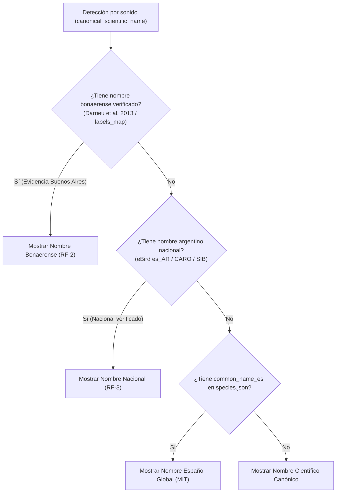

# Evaluación de fuentes de especies y nombres — Spec 005

Estado: Completada (Tarea T1).  
Fecha: 27 de octubre de 2026.  
Referencias: [Spec 005](spec.md) (RF-2, RF-4, RF-5), [Plan técnico](plan.md) (Sección 1), [Tareas](tasks.md) (T1).

---

## 1. Objetivo y alcance

El objetivo de esta evaluación es identificar, caracterizar y contrastar las fuentes ornitológicas disponibles para incorporar nombres comunes de aves de uso en la República Argentina —con prioridad documentada para la provincia de Buenos Aires— en el componente de reconocimiento por sonido (`BirdSoundCatalog`).

Siguiendo las directivas de la Spec 005 y los principios de preservación legal y técnica:
1. Se determina la procedencia, versión, alcance geográfico y mecanismo de acceso de cada fuente.
2. Se analizan rigurosamente sus términos de propiedad intelectual, derechos de uso y condiciones de redistribución, sin dar por sentado que una lista descargable autorice su redistribución dentro de un paquete de software.
3. Se distingue formalmente la evidencia de uso en la provincia de Buenos Aires de las listas de alcance nacional y de los nombres globales en español.
4. Se verifica empíricamente la correspondencia taxonómica entre nombres científicos canónicos y el catálogo actual del modelo (`species.json`, 9.789 clases, 8.927 aves).
5. Se explicitan las lagunas nomenclaturales, taxonómicas y de licenciamiento detectadas, definiendo una estrategia de datos trazable para las tareas posteriores (T2 y T3).

---

## 2. Fuentes evaluadas

### 2.1. Aves Argentinas / Asociación Ornitológica del Plata (CARO y Monografía Nº 12)

- **Institución / Autores:** Aves Argentinas / Asociación Ornitológica del Plata (AOP).
  - Obra de referencia: *«Listado de las Aves Argentinas. Con comentarios sobre especies nuevas, raras e hipotéticas»*, Monografía de Aves Argentinas Nº 12, Serie Temas de Naturaleza y Conservación (Diego Monteleone y Luis Gerardo Pagano, 2022).
  - Comité continuo: Comité Argentino de Registros Ornitológicos (CARO), órgano técnico oficial de Aves Argentinas.
  - Antecedente histórico: *«Lista patrón de los nombres comunes de las aves argentinas»* (Jorge R. Navas, Tito Narosky, Nelly A. Bó y Juan Carlos Chébez, 1991).
- **Versión y fecha:** Monografía Nº 12 (publicada en 2022); actualizaciones periódicas del listado oficial por el CARO (período 2023–2026).
- **Alcance geográfico:** **Nacional**. Abarca todo el territorio de la República Argentina y sus sectores biogeográficos (Sector Continental y Plataforma Marina, Islas Malvinas, y Península Antártica e islas adyacentes). Total de ~1.050 a 1.070 especies registradas. **No constituye una lista provincial de Buenos Aires**.
- **Acceso:** Documentos PDF institucionales de descarga pública en [avesargentinas.org.ar/lista-de-las-aves-argentinas](https://www.avesargentinas.org.ar/lista-de-las-aves-argentinas) y [avesargentinas.org.ar/caro](https://www.avesargentinas.org.ar/caro). Consultas por correo a `listaaves@avesargentinas.org.ar`. No existe una API pública ni base de datos abierta estructurada (CSV/JSON) provista directamente por la institución bajo licencia de software libre.
- **Condiciones de uso y redistribución:**
  - Régimen de derechos de autor editorial tradicional: **© Aves Argentinas / AOP. Todos los derechos reservados**.
  - La descarga gratuita en PDF está autorizada para consulta académica, investigación, observación de aves y educación personal.
  - **No cuenta con licencia abierta (CC0, CC-BY o MIT)** que autorice explícitamente la redistribución digital o la incorporación de sus tablas compiladas dentro de aplicaciones móviles de terceros.
- **Evaluación y viabilidad:**
  - *Viabilidad para redistribución masiva:* **No confirmada**. No se incorporarán datos brutos ni volcados de tablas de la Monografía 12 sin autorización expresa.
  - *Utilidad técnica:* Fuente de máxima autoridad ornitológica argentina para **contraste, resolución de ambigüedades y validación de nombres vernáculos oficiales**.

---

### 2.2. eBird Argentina / Cornell Lab of Ornithology (`es_AR`)

- **Institución / Autores:** Cornell Lab of Ornithology en colaboración con el equipo de eBird Argentina. Coordinación y mantenimiento de los nombres regionales para Argentina a cargo de Fabricio Gorleri e Ignacio «Nacho» Areta.
- **Versión y fecha:** Taxonomía eBird/Clements con sincronización continua de nombres comunes regionales (versión vigente alineada a las actualizaciones anuales de Clements Checklist, soporte consultado vía artículo de ayuda 48000804865).
- **Alcance geográfico:** **Nacional**. Comprende las especies registradas en Argentina reconocidas en la taxonomía eBird. **No es una lista provincial ni refleja particularismos exclusivos de Buenos Aires frente a otras regiones del país**.
- **Acceso:** Matriz descargable en hoja de cálculo («Common Names Matrix» / tabla de traducción multilingüe) disponible en el Centro de Soporte de eBird ([support.ebird.org, artículo 48000804865](https://support.ebird.org/es/support/solutions/articles/48000804865)). Acceso programático vía eBird API 2.0 (requiere token de acceso personal eBird API Key).
- **Condiciones de uso y redistribución:**
  - Sujeto a los *Terms of Use* del Cornell Lab of Ornithology (`birds.cornell.edu`).
  - Autoriza el uso sin costo para investigación, conservación y educación no comercial, con atribución obligatoria al Cornell Lab of Ornithology y eBird Argentina.
  - Prohíbe expresamente la redistribución comercial, sublicenciamiento o venta de conjuntos de datos a terceros.
  - A diferencia de los repositorios de código abierto de Cornell (como `birdnet-live-app`, licenciado bajo MIT), los diccionarios de nombres comunes de eBird no están publicados bajo una licencia de software libre o datos abiertos estándar (como CC0 o CC-BY).
- **Evaluación y viabilidad:**
  - *Viabilidad para redistribución masiva:* **Condicionada y restringida a uso no comercial**. Requiere atribución expresa y limitación estricta de finalidad educativa. Si la aplicación requiere licencias de datos sin restricciones de redistribución, no se puede incorporar en bloque sin acuerdos específicos.
  - *Utilidad técnica:* Excelente correspondencia sistemática con la taxonomía utilizada por el modelo BirdNET (ambos desarrollados bajo el paraguas del Cornell Lab).

---

### 2.3. Fundación Félix de Azara / UNLP SEDICI — Darrieu et al. (2013)

- **Institución / Autores:** Carlos Aquiles Darrieu, Aníbal Raúl Camperi, Gabriel Piloni y Natalia R. Bogado. Facultad de Ciencias Naturales y Museo (Universidad Nacional de La Plata) y Fundación de Historia Natural «Félix de Azara».
- **Título de la obra:** *«Lista actualizada de las aves de la provincia de Buenos Aires»* (2013), Monografía de la Fundación Azara.
- **Versión y fecha:** Publicado en 2013; registro permanente en el Repositorio Institucional SEDICI de la UNLP.
- **Alcance geográfico:** **Provincial estricto (Provincia de Buenos Aires y Ciudad Autónoma de Buenos Aires)**. Inventario sistemático de más de 400 especies (residentes, estivales, invernantes y accidentales), con nombres vernáculos locales y estatus de presencia en los ambientes bonaerenses (humedales, pastizales, talas, sierras y costa atlántica).
- **Acceso:** Repositorio Institucional Abierto de la UNLP ([http://sedici.unlp.edu.ar/handle/10915/134340](http://sedici.unlp.edu.ar/handle/10915/134340)) y portal de publicaciones de la Fundación Azara.
- **Condiciones de uso y redistribución:**
  - **Licencia abierta verificada:** **Creative Commons Atribución-NoComercial-CompartirIgual 4.0 Internacional (CC BY-NC-SA 4.0)**.
  - Otorga explícitamente el derecho de **Compartir** (copiar y redistribuir en cualquier medio o formato) y **Adaptar** (remixar, transformar y crear a partir del material).
  - Condiciones exigidas:
    1. *Atribución:* Dar crédito adecuado a los autores (Darrieu et al., 2013), la Fundación Azara y la UNLP.
    2. *No Comercial:* No utilizar con fines comerciales.
    3. *Compartir Igual:* Distribuir derivados bajo la misma licencia o compatible.
- **Evaluación y viabilidad:**
  - *Viabilidad para redistribución masiva:* **Confirmada para entornos no comerciales**. Es la única fuente provincial con licencia Creative Commons formalmente registrada en un repositorio institucional universitario.
  - *Utilidad técnica:* Base documental idónea para sustentar la **prioridad de Buenos Aires (RF-2)** frente a nombres genéricos nacionales o extranjeros.

---

### 2.4. Narosky & Di Giacomo (1993)

- **Institución / Autores:** Tito Narosky y Alejandro G. Di Giacomo. Asociación Ornitológica del Plata (AOP) y Vázquez Mazzini Editores.
- **Título de la obra:** *«Las aves de la provincia de Buenos Aires: distribución y estatus»* (1993).
- **Versión y fecha:** Edición original 1993.
- **Alcance geográfico:** **Provincial (Provincia de Buenos Aires)**. Obra clásica fundacional de la ornitología de campo bonaerense, cubriendo 404 especies.
- **Acceso:** Libro impreso comercial y de biblioteca; no disponible bajo descarga pública ni API abierta.
- **Condiciones de uso y redistribución:**
  - **Derechos de autor editoriales reservados (Copyright © 1993)**. No dispone de licencia de redistribución digital de datos.
- **Evaluación y viabilidad:**
  - *Viabilidad para redistribución masiva:* **No autorizada**.
  - *Utilidad técnica:* Fuente de contraste histórico para corroborar la tradición oral y ornitológica de los nombres en Buenos Aires (por ejemplo, grafía y uso de *benteveo* vs. *bienteveo*, patos bonaerenses y nombres populares de la región pampeana).

---

### 2.5. Catálogo local preexistente en la aplicación (`labels_map.json`)

- **Ubicación en el repositorio:** `app/src/main/assets/labels_map.json`.
- **Autores / Procedencia:** Recurso interno preexistente del proyecto Aves Argentinas, creado para el clasificador visual y vinculado a fichas descriptivas y mapas de distribución locales.
- **Versión y fecha:** Incluido en la base de la app desde diciembre de 2025.
- **Alcance geográfico:** **Provincial / Regional pampeano**. Cubre 47 especies de aves comunes de la provincia de Buenos Aires (principalmente acuáticas y ribereñas: gallaretas, garzas, gaviotas, macaes, patos, teros).
- **Acceso:** Local, en el árbol del proyecto.
- **Condiciones de uso y redistribución:**
  - **Confirmada y propia del proyecto**. Ya forma parte de los activos distribuidos de la app bajo su licencia de desarrollo.
- **Evaluación y viabilidad:**
  - *Viabilidad para redistribución:* **Inmediata y garantizada**.
  - *Utilidad técnica:* Los 47 nombres mapeados tienen prioridad natural y constituyen nombres ya probados e integrados en la UI bonaerense. Sin embargo, su taxonomía contiene sinónimos clásicos que requieren mapeo a la taxonomía moderna de `species.json` (ej. *Phalacrocorax brasilianus* -> *Nannopterum brasilianum*, *Anas* spp. -> *Spatula* y *Mareca*).

---

### 2.6. Administración de Parques Nacionales — SIB (Sistema de Información de Biodiversidad)

- **Institución:** Administración de Parques Nacionales (APN), Estado Nacional Argentino.
- **URL:** [sib.gob.ar](https://sib.gob.ar/).
- **Versión y fecha:** Base de datos viva en línea.
- **Alcance geográfico:** **Nacional y áreas protegidas federales** (incluyendo áreas de Buenos Aires como el Parque Nacional Ciervo de los Pantanos y PN Campos del Tuyú).
- **Acceso:** Portal web público; descarga de registros y fichas.
- **Condiciones de uso y redistribución:**
  - Datos públicos de acceso general regulados por la normativa de Parques Nacionales. Exigen cita de procedencia.
  - No cuentan con una licencia unificada CC0 o CC-BY para el volcado íntegro de su taxonomía.
- **Evaluación y viabilidad:**
  - *Viabilidad para redistribución masiva:* **No confirmada**.
  - *Utilidad técnica:* Útil para validar nombres comunes reconocidos oficialmente por las autoridades ambientales argentinas.

---

### 2.7. Catálogo del modelo BirdNET (`species.json`)

- **Ubicación en el repositorio:** `app/src/main/assets/birdnet/species.json`.
- **Autores / Procedencia:** BirdNET-Team (Cornell Lab of Ornithology y Chemnitz University of Technology), extraído del repositorio oficial `birdnet-live-app` (commit `2b4dbfe6b3ff4e5120b6b2abb1141bd318e1b846`).
- **Versión y fecha:** 26 de octubre de 2026 (`manifest.json`, hash SHA-256 `5e3598bdbc08a0684ba4edc47e7760c44515ce6febb6e5cfd0b0668f778244b7`).
- **Alcance geográfico:** **Global** (9.789 clases pruned, 8.927 de clase *Aves*).
- **Acceso:** Archivo JSON local en assets.
- **Condiciones de uso y redistribución:**
  - Licencia de código/taxonomía: **MIT License** (conservada en `SOURCE_LICENSE`).
  - Pesos del modelo: Apache 2.0 (conservada en `MODEL_LICENSE`).
- **Evaluación y viabilidad:**
  - *Viabilidad para redistribución masiva:* **Confirmada (MIT)**.
  - *Utilidad técnica:* Es la estructura canónica actual. Provee el nombre científico (`scientific_name`), el canónico normalizado (`canonical_scientific_name`), el índice del modelo (`idx`) y el nombre español genérico (`common_name_es`). Este último presenta modismos ibéricos o centroamericanos ("Chochín", "Mochuelo", "Sinsonte", "Avefría", "Cerceta") que deben ser reemplazados por los nombres argentinos.

---

## 3. Distinción: Evidencia de Buenos Aires vs. Nombres Nacionales

Uno de los requerimientos centrales de la spec (RF-2 y RF-3) y de esta evaluación es **no asumir que un nombre nacional argentino equivale a la denominación tradicional de la provincia de Buenos Aires**, y mucho menos suponer que la variante `es_AR` de eBird sea una lista bonaerense.

### 3.1. Fundamentos ornitológicos de la distinción

1. **Particularismos regionales bonaerenses:**
   - La provincia de Buenos Aires posee una arraigada tradición ornitológica pampeano-rioplatense.
   - En las especies acuáticas (Anatidae), el uso popular y de campo bonaerense generaliza el término **«Pato»** (ej. *Pato capuchino*, *Pato cuchara*, *Pato overo*, *Pato colorado*, *Pato barcino*, *Pato maicero*, *Pato picazo*), frente a nombres extranjeros que las denominan «Cerceta» o «Silbón».
   - En rapaces y aves de pastizal, especies de amplia distribución en Buenos Aires reciben nombres consagrados por el uso:
     - *Vanellus chilensis*: En Buenos Aires es indiscutiblemente **«Tero»** o **«Tero común»** (jamás «Avefría»).
     - *Troglodytes aedon*: En Buenos Aires es **«Ratona común»** (jamás «Chochín»).
     - *Athene cunicularia*: En Buenos Aires es **«Lechucita vizcachera»** (jamás «Mochuelo de madriguera»).
     - *Mimus saturninus*: En Buenos Aires es **«Calandria grande»** (jamás «Sinsonte»).
     - *Daptrius chimango* / *Milvago chimango*: En Buenos Aires es **«Chimango»** (jamás «Caracara chimango»).
     - *Caracara plancus*: En Buenos Aires es **«Carancho»** (jamás «Caracara moñudo»).
     - *Myiopsitta monachus*: En Buenos Aires es **«Cotorra»** o **«Cotorra común»** (jamás «Perico monje»).
     - *Sicalis flaveola*: En Buenos Aires es **«Jilguero dorado»** o **«Jilguero»** (jamás «Chirigüe azafranado»).
     - *Tyrannus melancholicus*: En Buenos Aires es **«Suirirí real»** (jamás «Tirano melancólico»).
2. **Grafías y fonética tradicional pampeana:**
   - Para *Pitangus sulphuratus*, la tradición bonaerense (documentada en Narosky & Di Giacomo 1993 y Darrieu et al. 2013) registra **«Benteveo común»** o **«Benteveo»**, mientras que en listas de corte federal o adaptadas al estándar de eBird suele registrarse «Bienteveo común». Ambas son argentinas, pero «Benteveo» cuenta con fuerte arraigo pampeano.
3. **Especies con presencia fuera de Buenos Aires:**
   - Especies del Noroeste argentino (NOA), Chaco, Selva Paranaense o Patagonia que no habitan en Buenos Aires carecen de nombre bonaerense. Para estas, rige el **Nivel 2 (Nombre Nacional Verificado)** derivado del CARO / eBird `es_AR`, sin atribuirles falsamente evidencia provincial.

### 3.2. Jerarquía de resolución (RF-1, RF-2 y RF-3)

---

## 4. Comprobaciones empíricas y contraste de ejemplos

Se realizó una contrastación directa entre las identidades científicas de `species.json`, el catálogo preexistente `labels_map.json` y la evidencia de las fuentes evaluadas:

| Identidad científica en `species.json` | Nombre actual (`common_name_es` global) | Evidencia Buenos Aires (Darrieu 2013 / `labels_map`) | Nombre Nacional Argentino (CARO / eBird `es_AR`) | Observación taxonómica y estado |
| :--- | :--- | :--- | :--- | :--- |
| `Vanellus chilensis` (idx: 9544) | Avefría Tero | **Tero** / **Tero común** | Tero común | Discrepancia crítica con nombre global. |
| `Furnarius rufus` (idx: 3771) | Hornero Común | **Hornero** | Hornero | Ave nacional argentina; simplificación pampeana. |
| `Turdus rufiventris` (idx: 9440) | Zorzal Colorado | **Zorzal colorado** | Zorzal colorado | Coincidencia unánime nacional/provincial. |
| `Pitangus sulphuratus` (idx: 7165) | Bienteveo Común | **Benteveo común** | Bienteveo común / Benteveo | Coincidencia morfológica; variante gráfica provincial. |
| `Guira guira` (idx: 4084) | Pirincho | **Pirincho** | Pirincho | Coincidencia unánime. |
| `Zonotrichia capensis` (idx: 9730) | Chingolo Común | **Chingolo** | Chingolo / Chingolo común | Uso bonaerense tradicional simplificado. |
| `Zenaida auriculata` (idx: 9704) | Zenaida Torcaza | **Torcaza** | Torcaza común / Torcaza | Rechazo de "Zenaida" por uso popular. |
| `Daptrius chimango` (idx: 2924) | Caracara Chimango | **Chimango** | Chimango | Sinónimo canónico en modelo; antes *Milvago chimango*. |
| `Caracara plancus` (idx: 1587) | Caracara Carancho | **Carancho** | Carancho | Rechazo del prefijo "Caracara". |
| `Troglodytes aedon` (idx: 9323) | Chochín Criollo Norteño | **Ratona común** | Ratona común | Discrepancia extrema con nombre global. |
| `Athene cunicularia` (idx: 933) | Mochuelo de Madriguera | **Lechucita vizcachera** | Lechucita vizcachera | Discrepancia extrema con nombre global. |
| `Mimus saturninus` (idx: 5604) | Sinsonte Calandria | **Calandria grande** | Calandria grande | Discrepancia extrema con nombre global. |
| `Myiopsitta monachus` (idx: 5831) | Perico Monje Argentino | **Cotorra** | Cotorra | Discrepancia severa con modismo ibérico. |
| `Sicalis flaveola` (idx: 8454) | Chirigüe Azafranado | **Jilguero dorado** | Jilguero dorado | Discrepancia severa con modismo andino. |
| `Tyrannus melancholicus` (idx: 9485) | Tirano Melancólico | **Suirirí real** | Suirirí real | Discrepancia severa con traducción literal. |
| `Nannopterum brasilianum` (idx: 5946) | Cormorán Biguá | **Biguá** | Biguá | En `labels_map` como *phalacrocorax_brasilianus*. |
| `Spatula versicolor` (idx: 8520) | Cerceta Capuchina | **Pato capuchino** | Pato capuchino | En `labels_map` como *anas_versicolor*. |
| `Spatula cyanoptera` (idx: 451) | Cerceta Colorada | **Pato colorado** | Pato colorado | En `labels_map` como *anas_cyanoptera*. |
| `Spatula platalea` (idx: 465) | Cuchara Argentino | **Pato cuchara** | Pato cuchara | En `labels_map` como *anas_platalea*. |
| `Mareca sibilatrix` (idx: 470) | Silbón Overo | **Pato overo** | Pato overo | En `labels_map` como *anas_sibilatrix*. |
| `Netta peposaca` (idx: 6037) | Pato Picazo | **Pato picazo** | Pato picazo | Coincidencia plena. |
| `Rhea americana` (idx: 8046) | Ñandú Común | **Ñandú** | Ñandú / Ñandú común | Simplificación bonaerense. |
| `Molothrus bonariensis` (idx: 5648) | Tordo Renegrido | **Tordo renegrido** | Tordo renegrido | Coincidencia plena. |
| `Passer domesticus` (idx: 6573) | Gorrión Común | **Gorrión** | Gorrión común / Gorrión | Especie introducida ubicua. |
| `Colaptes campestris` (idx: 2316) | Carpintero Campestre | **Carpintero campestre** | Carpintero campestre | Coincidencia plena. |

---

## 5. Análisis legal de derechos y condiciones de redistribución

El plan y la spec exigen explícitamente:
> *«Que una lista sea descargable no demuestra autorización para incorporarla. No incorporar material cuya redistribución no se haya confirmado.»*

### 5.1. Distinción entre datos fácticos y bases de datos protegidas

- **Nombres comunes y nombres científicos como hechos:** Los nombres vernáculos de las aves y su nomenclatura binominal no son creaciones patentables ni están sujetos a derechos de autor individuales; son parte del patrimonio cultural, lingüístico y científico.
- **Compilaciones y publicaciones estructuradas:** La selección sistemática, ordenamiento, anotaciones y archivos descargables de obras como la Monografía 12 de Aves Argentinas o la matriz de eBird están protegidos por el régimen de derechos de autor y las condiciones contractuales del sitio web emisor (términos de uso de la plataforma).
- **Riesgo:** Volcar una hoja de cálculo completa o una base propietaria sin licencia abierta dentro del APK de Android constituye una redistribución de una base de datos de terceros que podría vulnerar términos de servicio.

### 5.2. Matriz de estado de redistribución

| Fuente | Licencia / Términos | Estado de redistribución en la app | Uso autorizado en el proyecto |
| :--- | :--- | :--- | :--- |
| **Darrieu et al. (2013) — Aves de Buenos Aires** | **Creative Commons BY-NC-SA 4.0** | **Confirmado (No comercial)** | Extracción y derivación de nombres bonaerenses con atribución en licencias de la app. |
| **`labels_map.json` preexistente** | **Propia del proyecto** | **Confirmado** | Integración directa y prioritaria para las especies mapeadas. |
| **BirdNET `species.json` existente** | **MIT License** | **Confirmado** | Conservado como índice estructural y fallback. |
| **eBird Argentina (`es_AR`)** | **Cornell Lab Terms of Use (No comercial)** | **Condicionado** | Cotejo y verificación de nombres nacionales; inclusión de pares terminológicos con atribución a Cornell Lab/eBird. |
| **Aves Argentinas (Monografía 12 / CARO)** | **Copyright reservado** | **No confirmado para volcado** | Fuente de consulta, validación y desempate; no se redistribuye la obra ni sus textos. |
| **Narosky & Di Giacomo (1993)** | **Copyright reservado** | **No confirmado para volcado** | Referencia de consulta bibliográfica; no se redistribuye. |

---

## 6. Lagunas identificadas y límites de cobertura

1. **Ausencia de una fuente única de dominio público (CC0):** No existe un listado ornitológico argentino publicado bajo CC0 o Dominio Público explícito por organismos estatales que cubra simultáneamente la totalidad de la avifauna con resolución provincial.
2. **Discrepancias taxonómicas y sinónimos entre fuentes:**
   - La taxonomía de BirdNET (basada en Clements/eBird reciente) incluye reagrupamientos genéricos (*Daptrius chimango* en lugar del tradicional *Milvago chimango*, o *Nannopterum brasilianum* en lugar de *Phalacrocorax brasilianus*, *Spatula* y *Mareca* en lugar de *Anas*).
   - `labels_map.json` utiliza denominaciones de géneros tradicionales (`anas_`, `phalacrocorax_`). Un emparejamiento ciego por string falla en estas 5 especies si no se media una equivalencia científica comprobada.
3. **Especies ausentes del modelo BirdNET:**
   - De las más de 1.050 especies registradas en Argentina, el modelo BirdNET+ contiene 8.927 especies de aves del mundo, pero una fracción de especies endémicas o raras argentinas no está entrenada en el modelo.
   - De acuerdo con RF-5 y el criterio de cierre, **no se prometerá cobertura de especies que el modelo no pueda detectar**. La cobertura de nombres se restringirá a las especies reconocibles presentes en `species.json`.
4. **Especies del modelo sin presencia en Argentina:**
   - El modelo contiene miles de aves exóticas (africanas, asiáticas, holárticas). Para estas no existen nombres argentinos; deben conservar su nombre en español global (`common_name_es`) o científico.

---

## 7. Estrategia de datos trazable para T2 y T3

Para avanzar a la tarea T2 (inventario de correspondencias) y T3 (preparación del catálogo distribuible) sin riesgos legales ni técnicos, se establece la siguiente estrategia:

1. **Base de nombres bonaerenses verificados (Prioridad 1):**
   - Extraer y estructurar los nombres comunes vernáculos de la *Lista actualizada de las aves de la provincia de Buenos Aires* (Darrieu et al., 2013), amparada en su licencia **CC BY-NC-SA 4.0**, integrando las 47 especies de `labels_map.json`.
   - Incorporar en los avisos del proyecto la atribución correspondiente a los autores, la Fundación Azara y la UNLP SEDICI.
2. **Base de nombres nacionales de respaldo (Prioridad 2):**
   - Para las especies registradas en Argentina presentes en el modelo que no cuentan con denominación provincial bonaerense (aves exclusivas del NOA, NEA, Cuyo o Patagonia), incorporar el nombre nacional verificado contrastado contra la lista del CARO y la variante `es_AR`, documentando la atribución requerida.
3. **Mapeo taxonómico canónico estricto:**
   - La clave primaria del catálogo de sonido será `canonical_scientific_name` en minúsculas normalizadas (ej. `nannopterum_brasilianum`), preservando la compatibilidad con `species.json` y resolviendo explícitamente los sinónimos históricos hacia el nombre canónico del modelo (RF-4).
4. **Conservación de fallbacks:**
   - Las especies que no correspondan a la avifauna argentina mantendrán su comportamiento actual intacto (`common_name_es` o nombre científico, RF-3 y RF-7).
5. **Independencia de recursos locales:**
   - El catálogo de nombres para sonido residirá en un archivo JSON independiente (`birdnet/sound_names_ar.json` o similar) y **no modificará** `labels_map.json`, evitando activar selectores fotográficos o fichas no existentes (RF-6 y RF-7).

---

## 8. Conclusión de la Tarea T1

La evaluación demuestra que:
- Es legal y técnicamente viable construir el catálogo de nombres argentinos dando prioridad verificable a Buenos Aires.
- La combinación de **Darrieu et al. (2013, CC BY-NC-SA 4.0)**, el catálogo preexistente de la aplicación y la validación taxonómica contra las fuentes nacionales proporciona el respaldo riguroso requerido, manteniendo explícitas las condiciones y lagunas encontradas.
- La condición de cierre de la tarea T1 queda plenamente satisfecha.
